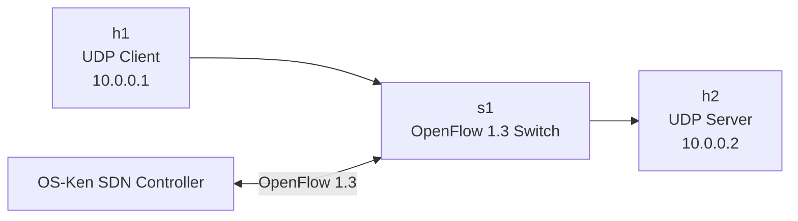

# Reliable UDP File Transfer over SDN

## 1. Project Overview

This project implements a reliable file-transfer application using UDP sockets and an SDN-controlled network.

A UDP client sends a file from Mininet host h1 to a UDP server running on h2. An OpenFlow 1.3 switch forwards traffic under the control of an OS-Ken SDN controller.

## 2. Architecture



## 3. Technologies Used

- Python 3
- UDP socket programming
- Mininet
- Open vSwitch
- OpenFlow 1.3
- OS-Ken SDN controller
- SHA-256 file integrity verification

## 4. Project Structure

```text
udp-reliable-transfer/
├── client.py
├── server.py
├── controller.py
├── sample.txt
├── received_files/
├── evidence/
│   └── flow-table.txt
├── .venv-controller/
└── README.md
```

## 5. Application Design

### UDP Client
- Reads the selected file.
- Sends file metadata to the server.
- Divides the file into chunks.
- Uses sequence numbers and acknowledgements.
- Retransmits packets when acknowledgements time out.
- Sends a final SHA-256 digest.

### UDP Server
- Listens for incoming file transfers.
- Receives and acknowledges data packets.
- Reassembles the file.
- Verifies the SHA-256 digest.
- Saves the received file.

### SDN Controller
- Uses OpenFlow 1.3.
- Learns source MAC addresses.
- Installs forwarding rules dynamically.
- Sends unknown traffic to the controller for processing.

## 6. Network Topology

| Component | Configuration |
|---|---|
| Controller | OS-Ken |
| Switch | s1 (Open vSwitch) |
| Protocol | OpenFlow 1.3 |
| Client host | h1 |
| Client IP | 10.0.0.1 |
| Server host | h2 |
| Server IP | 10.0.0.2 |
| UDP port | 5001 |

## 7. Execution Instructions

Run commands in separate terminal windows.

### Terminal 1: Start the SDN controller

```bash
cd ~/udp-reliable-transfer
source .venv-controller/bin/activate
osken-manager controller.py --ofp-tcp-listen-port 6653
```

### Terminal 2: Start Mininet

```bash
sudo mn --topo single,2 --mac \
--switch ovsk,protocols=OpenFlow13 \
--controller remote,ip=127.0.0.1,port=6653
```

### Terminal 2: Start UDP server inside h2

At the Mininet prompt:

```text
h2 python3 /home/dushyanth/udp-reliable-transfer/server.py
```

### Terminal 3: Send a file from h1

Find the h1 process ID:

```bash
pgrep -af mininet:
```

Use the PID shown for `mininet:h1`:

```bash
sudo mnexec -a H1_PID python3 \
/home/dushyanth/udp-reliable-transfer/client.py \
/home/dushyanth/udp-reliable-transfer/sample.txt 10.0.0.2
```

Replace `H1_PID` with the actual process ID.

## 8. Testing and Results

| Test | Expected result | Observed result |
|---|---|---|
| Mininet pingall | Hosts communicate | 0% packet loss |
| h1 to h2 ping | Successful connectivity | 3/3 packets received |
| UDP file transfer | File received successfully | Successful |
| File integrity | Matching SHA-256 | Matching hashes |
| File comparison | Identical files | cmp returned 0 |
| OpenFlow flow inspection | Forwarding rules present | Rules observed on s1 |

### File Transfer Result

- File: sample.txt
- File size: 60 bytes
- Transfer status: Successful
- SHA-256:

```text
414bea518a32720c5fb43364cb3f2a4d1e5509c83598bb03088c49d7ec826b14
```

### OpenFlow Evidence

The switch flow-table output is saved in:

```text
evidence/flow-table.txt
```

It contains controller-installed forwarding rules and packet counters.

## 9. Limitations and Future Work

- Current implementation uses Stop-and-Wait ARQ.
- Extensive packet-loss and congestion testing remains to be performed.
- Future improvements can include sliding-window transmission, dynamic SDN routing and performance evaluation.

## 10. Conclusion

The project demonstrates reliable file transfer using UDP sockets over a Mininet network controlled by an OS-Ken SDN controller through OpenFlow 1.3. Successful file delivery and matching SHA-256 hashes verify the basic end-to-end operation.
